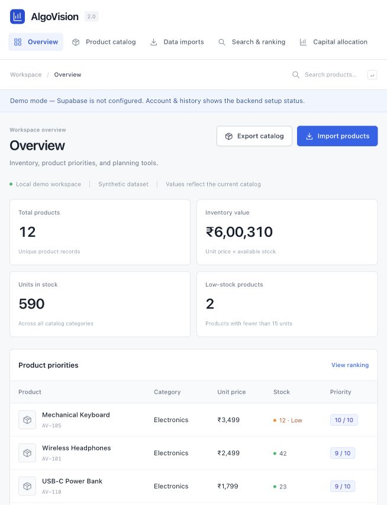

# AlgoVision 2.0 — Analytics workspace

A modular DSA capstone covering e-commerce catalog analytics, capital allocation and logistics routing. Version 1.1 added a Node application API and Supabase Auth/Postgres integration. Sample data is synthetic; algorithms are explicitly implemented in JavaScript.

Runs with Node.js 20+ and no npm dependencies. Start in local demo mode, or configure your own Supabase project for authentication and persistent data. Credentials are not included; use `.env.example` and [the backend setup guide](docs/SUPABASE_SETUP.md).



*Overview shown with synthetic sample data. The application also includes product search, an editable allocation table, graph routing, and account history.*

## Start

Use Node.js 20+. No npm dependencies or installation are required.

```sh
cd AlgoVision-2.0
npm start
```

Open http://127.0.0.1:4173. Keep the terminal running; Ctrl+C stops it. On macOS, double-click Run-AlgoVision.command or run `sh Run-AlgoVision.command`. The launcher can use the installed Codex Node runtime if the system Node is broken. A Python static server cannot run this backend.

```sh
npm test
npm run check
```

For another port, set PORT in .env (for example 4174) and use the matching URL.

## Connect Supabase

1. Provision a project and apply supabase/migrations/202610310001_backend.sql once.
2. Copy .env.example to .env; fill your HTTPS project URL and publishable key. Never use a service_role/secret key.
3. Restart Node. Open Account & history, create/confirm an email account, and sign in.
4. Seed your new empty catalog using Load sample catalog, import JSON, or explicitly migrate this browser's demo catalog.

Detailed setup, schema, API, policies, session design and limitations are in docs/SUPABASE_SETUP.md. No credentials are included. Use your own authorized Supabase project when running a clone of this repository.

## Features

- **Data ingestion:** manual/JSON imports, explicit FIFO queue, schema validation, hash duplicate rejection, row receipts, atomic Supabase RPC.
- **Cataloging:** arrays, filters, sorting, deletion, inventory valuation and category aggregation.
- **Search:** exact hash lookup, balanced BST price ranges, bounded heap top-K priority ranking.
- **Optimization:** ratio greedy, exact 0/1 knapsack with traceback, and separately labeled fractional upper bound. Cloud mode computes and saves results on the server.
- **Graphs:** custom min-heap Dijkstra over a synthetic weighted delivery graph, SVG route highlighting. Cloud mode computes and saves on the server.
- **Cloud workspace:** email/password authentication, private per-user catalog, import/run history, saved report exports, explicit refresh across devices.
- **Algorithm lab:** complexity reference and actual scan-versus-index timing experiment.

Added efficiency features include balanced batch-built price indexing, bounded top-K memory, one index rebuild per batch, stale-entry skipping/early route termination, bounded JSON/DP inputs and paginated cloud reads.

## Storage behavior

When Supabase is configured, cloud catalog operations require sign-in. Browser tokens are not stored in localStorage; an HttpOnly cookie identifies a server-held session. Supabase RLS isolates each user's rows. Catalogs persist in Postgres across devices; use Refresh cloud data or reload to see changes. Runs/imports are retained in the database, with the latest 20 of each shown in the app.

When not configured, an explicit demo banner appears and the original browser-local catalog works. Demo records are never automatically uploaded. Imports append new IDs; existing IDs are skipped. IDs are case-sensitive. Invalid rows are rejected individually. Cloud import batches and reset operations are transactional. Export returns an importable catalog array. Reset replaces the current catalog after confirmation, preserving cloud history.

The route graph is fixed in the UI; Graph accepts arbitrary valid graphs in code. Inventory, capital opportunities and logistics are separate planning inputs in one studio. Opening a calculation page runs and saves its default example in cloud mode; report history preserves the inputs and results. Sessions expire after 12 hours and are lost on server restart; database data is retained.

## Files

```text
server.mjs                   Local HTTP server, API dispatch, environment loading
backend/api.mjs              Authentication/session, validation, compute/data routes
backend/supabase.mjs         Supabase Auth/PostgREST adapter
supabase/migrations/         Tables, indexes, RLS, atomic import/reset functions
supabase/tests/access.sql    Database policy tests (requires live/local Supabase)
.env.example                 Configuration template; actual .env is private
index.html                   App shell
src/algorithms.js            Explicit queue, heap, BST, catalog, DP, greedy, graph
src/cloud.js                 Same-origin browser API client
src/app.js                   Views, cloud flows, demo persistence, exports
src/sample-data.js           Synthetic catalog, opportunities, network
src/style.css                Responsive offline styling
tests/                       Algorithm + backend contract tests
sample-*.json                Import/demo data and reproducible example reports
screenshots/                 Verified UI previews
docs/PROJECT_REPORT.md       Project objectives, modules, architecture, outcomes
docs/COMPLEXITY.md           Algorithmic complexity and efficiency analysis
docs/SUPABASE_SETUP.md       Backend setup, API and operational boundaries
docs/DEMO_SCRIPT.md          Timed 5–10 minute presentation script
docs/SUBMISSION_CHECKLIST.md PDF requirements and remaining personal steps
docs/TEST_REPORT.md          Verification and explicit live-cloud test limits
```

## Validation and limits

19 Node tests pass, including independent algorithm references and mocked Supabase API contracts. The live schema is applied, all 21 pgTAP access-policy checks passed, and 22 live HTTP checks verified login, import/reset/delete, computed results, history and persistence across independent login sessions. An actual second physical device was not used. A runnable policy suite is included.

This is a loopback capstone application, not a public production deployment. It has no payment processing, live traffic feed, realtime subscriptions, OAuth or password recovery interface. Sessions are in server memory. Deployment requires HTTPS, a shared session store as appropriate, and explicit permitted origins. Core algorithm complexity excludes network/Auth/database overhead.

## Submission

Fill in your personal details in the report and script, understand the algorithms, then record a 5–10 minute MP4. The introduction must be English; the walkthrough may be English or Hindi. Use docs/SUBMISSION_CHECKLIST.md for Drive sharing, LinkedIn video/tags, Google review screenshot and the email-provided final form. Those external steps are not performed by this package. The supplied deadline is 31 October 2026 with no stated time/timezone.

Prepared against DSA Capstone Project 1.pdf and Capstone_Project_Submission_Guidelines_Sep_2026.pdf. All sample values are invented. Review, customize and disclose AI assistance if your institution requires it. No company endorsement or certification is claimed.

## Interface revision (v1.2)

The interface was redesigned after inspecting the five related repositories listed in docs/UI_REFERENCE_REVIEW.md. It uses task-based navigation, standard tables/forms and split planning panels. The optimizer now has an editable opportunity table; JSON is an advanced option. Global product search opens the filtered catalog. The Supabase backend and required DSA modules are retained. No unlicensed repository source or assets were copied.
